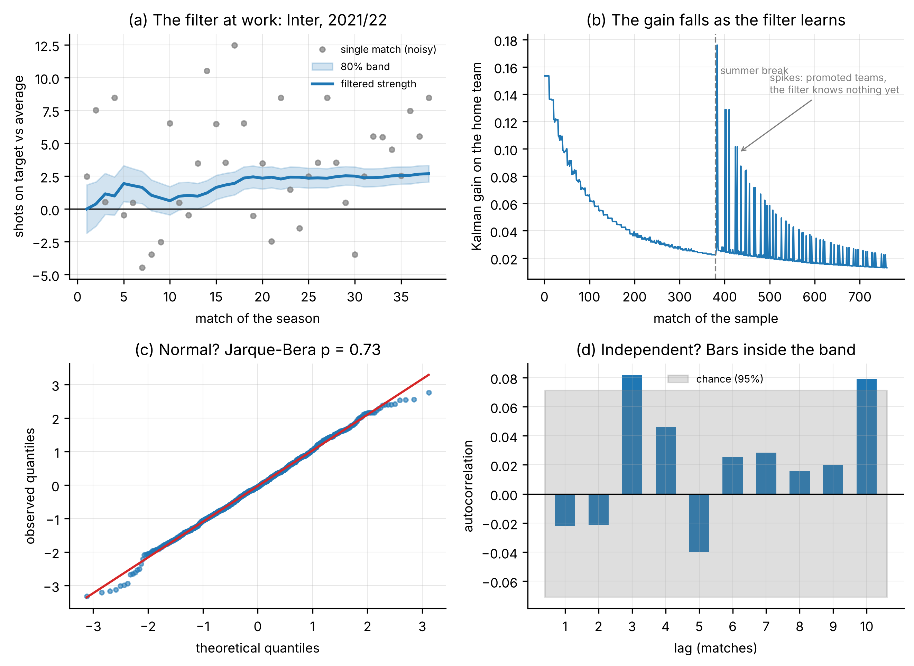
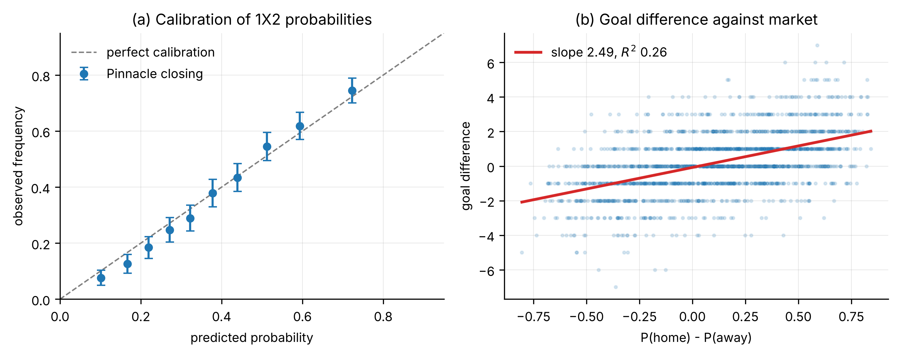
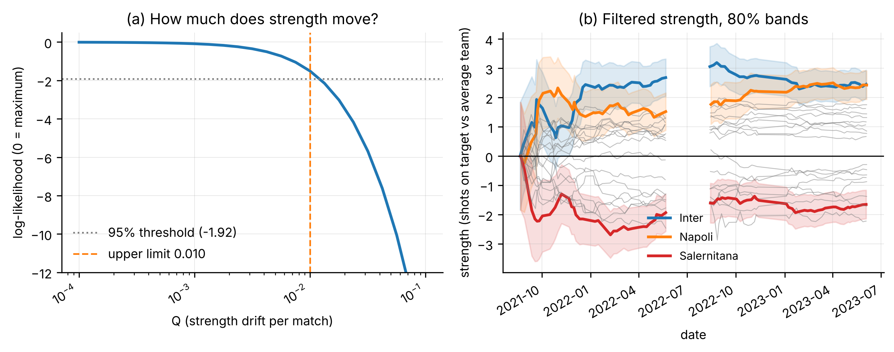
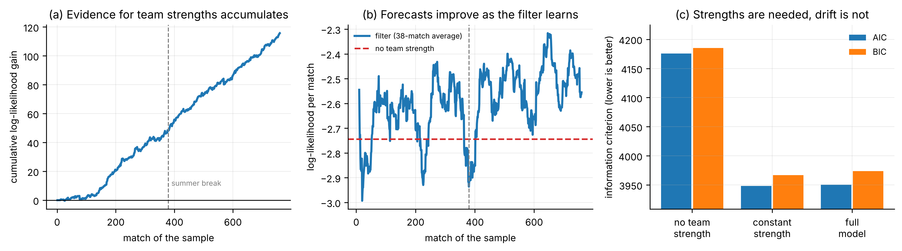
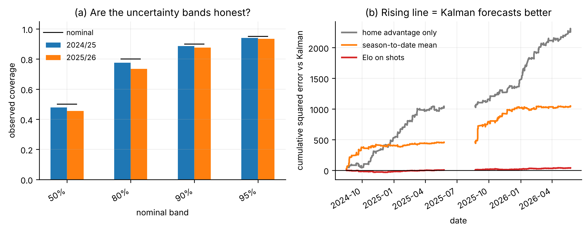
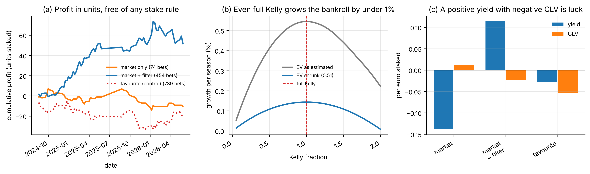

# Market efficiency and a state-space model of team strength

A quantitative study of the Serie A betting market, 2018/19 – 2026/27.

The project asks one question: **does a Kalman filter on team strength contain information that
closing odds do not already price?** The answer, across every test run here, is no. The repository
documents that result together with the controls that make a negative finding credible.



*The filter in one picture. Panel (a): a single match is a terrible measurement — the grey dots
scatter from −4.5 to +12.5 shots on target — yet the filtered strength (blue) settles smoothly
around +2.5 for Inter. Panel (b): the Kalman gain decays as evidence accumulates, and spikes again
for newly promoted teams the filter knows nothing about. Panels (c) and (d): the standardised
innovations are normal (Jarque–Bera p = 0.73) and serially uncorrelated, which is what a correctly
specified filter should produce.*

---

## Main results

| Finding | Evidence |
|---|---|
| The filter adds nothing to closing odds | Encompassing coefficient `c = −0.027`, `p = 0.73`, n = 739 |
| The filter adds nothing to Friday odds | Estimated weights negative: `−0.038`, `−0.135` |
| The filter is still a real model | Out-of-sample log-loss 0.978 vs 1.085 for base rates |
| …but the market beats it | Log-loss 0.978 vs 0.961, `t = 2.86`, `p = 0.004` |
| Betting on its disagreements loses | Believed EV `+16.96%`, realised return `−8.89%` on 726 bets |
| Team strength barely evolves in season | ML estimate `Q ≈ 0`, boundary LR test does not reject |
| Observation noise is near its Poisson floor | `R = 9.68` against a counting floor of 8.53 (13% above) |
| The market prices goal dependence | Implied `l₃` median 0.177, never zero across 2213 matches |
| The implied surface is near arbitrage-free | Asian handicap, excluded from calibration, predicted to 0.27 pp |
| Bookmaker margins differ a lot | 3.9% (Netwin) to 11.6% (LeoVegas), paired `p < 0.001` |

The two controls that make the negative result meaningful:

- **positive control** — true shots plus noise fed to the same pipeline: `t = +3.28`, signal found.
- **negative control** — shuffled filter forecasts: `t = −0.08`, nothing found.

The test detects information when it is there and stays silent when it is not.

---

## The argument in figures

### 1. The market is well calibrated to begin with



*De-vigged Pinnacle closing probabilities sit on the 45-degree line across the whole range, and the
market's implied edge maps linearly onto realised goal difference (slope 2.49). Any model has to
beat this, not a straw man.*

### 2. How much does strength actually move?



*Panel (a): the profile likelihood for `Q`, the drift of strength per match, is flat near zero and
falls off a cliff above 0.01 — the 95% upper limit. Strength is close to a constant within a
season. Panel (b): filtered strengths with 80% bands. Inter and Napoli separate from the pack,
Salernitana sits below it, and the summer break resets the promoted teams.*

### 3. Strengths are needed, drift is not



*Panel (a): evidence for team-specific strengths accumulates steadily, over 110 log-likelihood
points. Panel (b): the filter's per-match forecast rises above the no-strength benchmark and stays
there. Panel (c): AIC and BIC both reject "no team strength" decisively, but a model with
**constant** strength ties with the full model — adding drift buys nothing.*

### 4. Honest uncertainty, and a real forecasting edge over naive benchmarks



*Panel (a): the 80%, 90% and 95% bands cover close to nominal out of sample, so the filter's stated
uncertainty is honest. Panel (b): cumulative squared error against three benchmarks. The filter
clearly beats home-advantage-only and the season-to-date mean, and ties with a tuned Elo. It is a
working forecaster — it just has no edge over the market.*

### 5. The false positive we caught



*Panel (a): "market + filter" looks like a winner, with a cumulative profit of over 50 units.
Panel (c) kills it: the same strategy has **negative closing line value**. A positive yield with
negative CLV is luck, not edge, and the strategy was betting 64% draws because of a recalibration
artefact. Panel (b): even under full Kelly with the estimated edge, growth would be under 1% per
season.*

### The remaining figures

| Figure | Content |
|---|---|
| `fig2_goal_models.pdf` | Implied goal intensities, Dixon–Coles τ and the bivariate Poisson |
| `fig3_persistence.pdf` | Persistence test on residuals with 1000 permutations |
| `fig4d_profiles.pdf` | Profile likelihood for every estimated parameter |
| `fig7_application.pdf` | Application to the 2026/27 season in progress |
| `fig8_friday_card.pdf` | The Friday card: what the filter says before a round |

All figures are in `paper/figures/`, as PDF for LaTeX and PNG for viewing.

---

## Layout

```
notebook/serie_a_study.ipynb     the full study, 11 code cells, runs end to end in ~145 s
paper/serie_a_paper.tex          the write-up (LaTeX source)
paper/serie_a_paper.pdf          compiled, 16 pages
paper/figures/                   11 figures, PDF and PNG, white background
analysis/                        standalone scripts, each prints its own tables
data/                            one CSV per season, football-data.co.uk
```

### Scripts in `analysis/`

| File | What it does |
|---|---|
| `kalman_current.py` | Fits the league Kalman filter by maximum likelihood, prints current team strengths |
| `kalman_vs_market.py` | Kalman vs closing odds as 1X2 forecasters, out of sample, plus the encompassing test |
| `implied_surface_independent.py` | Inverts odds to goal intensities under independent Poisson, maps the draw premium |
| `implied_surface_bivariate.py` | Exact bivariate-Poisson calibration on 1X2 + Over 2.5, blind test on Asian handicap |
| `bookmaker_margins.py` | Margins across 19 bookmakers on one round, paired tests, best-price comparison |

Run any of them directly; paths are relative to the repository.

```bash
pip install -r requirements.txt
python analysis/kalman_current.py
```

The notebook expects to be run from `notebook/`, and reads `../data`.

---

## Method notes

Every parameter is estimated, none is chosen by hand. The filter has five:
`Q`, `R`, `h`, `Q_summer`, `P0`, all fitted by maximum likelihood through the prediction error
decomposition. Protocols were written before results were seen, and departures from them are
declared in the paper.

The state vector holds one strength per team with a full covariance matrix, so a result between
two teams updates the whole league, not just the two involved. The observation is the difference
in shots on target, the test on `Q = 0` sits on a boundary and uses the `½χ²₀ + ½χ²₁` mixture
of Self and Liang (1987), and profile likelihood intervals use the `−1.92` threshold.

### Declared limitations

- Past goal difference predicts future goal difference slightly better than past shot difference
  does, at almost every horizon (0.771 vs 0.750 over a half-season). Shots still carry independent
  information (`p = 0.040` in the joint regression) and are the more persistent measure, but the
  choice of variable is a real limitation rather than a settled question.
- `R` is a nuisance parameter that absorbs both irreducible counting noise and misspecification,
  and it varies between 7.2 and 9.7 across seasons.
- Shots-on-target definitions break after 2020/21 and again in 2026/27.
- Pinnacle quotes are missing from January 2026; Betfair Exchange is used as a fallback.
- The 2019/20 season is absent from the data.

---

## Data

Match results and odds come from [football-data.co.uk](https://www.football-data.co.uk/italym.php),
one file per season, unmodified apart from being renamed by season. They are included so the study
reproduces as it stands. Refer to that site for its own terms of use.

---

## Licence

MIT, see `LICENSE`. The licence covers the code and the write-up, not the data.
